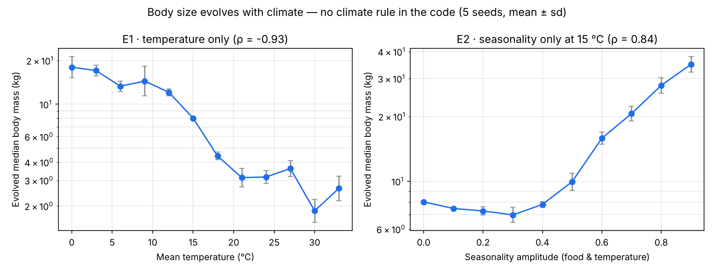
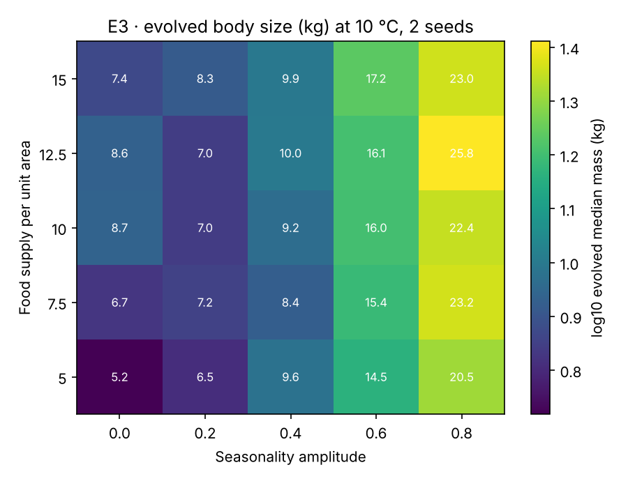
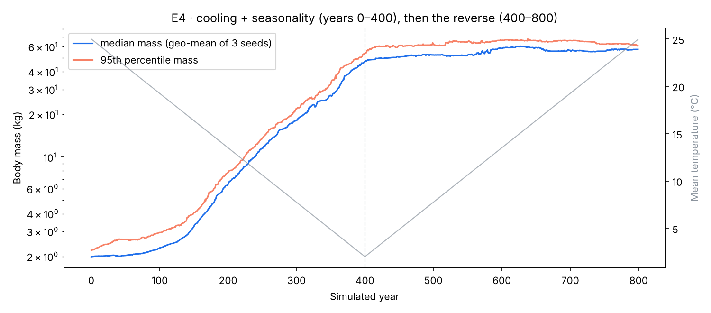

# bio-evolution-sim

**Does climate select body size when nothing in the code tells it to?**
An agent-based model in which body mass, fur insulation and locomotion evolve only through energy balance, competition, starvation and reproduction.



**Main results (v1)**
- **Cold selects bigger bodies.** Over 12 temperatures × 5 seeds, the evolved median mass falls as temperature rises (Spearman ρ = −0.93, p < 10⁻²⁶): about 18 kg at 0 °C against 2–4 kg above 20 °C.
- **Seasonality selects bigger bodies.** Over 10 seasonality levels × 5 seeds at 15 °C, mass rises with seasonality (ρ = +0.84, p < 10⁻¹³): from ~8 kg with no seasons to ~35 kg with harsh winters.
- **Both effects are robust.** They hold in **81 of 81** combinations of the three thermal constants and food supply (E3).
- **Warmth does not reverse them.** When climate warms again after a cold period, body size stays large (E4). The reason is in the [Limitations](#limitations).

---

## 1. Model

Each individual *i* is a row in parallel NumPy arrays (Structure of Arrays): `mass`, `insulation`, `locomotion`, `energy`. One tick:

1. Food regrows toward `capacity × season(t)`. In a hard winter, season = 0 and standing food decays.
2. Agents compete for food. Each one demands `3 · L^0.6 · M^0.75`, and the pool is split in proportion to demand.
3. Energy is updated as `E ← min(E + intake − costs, 25·M)`, where

| Cost | Scaling | Source |
|---|---|---|
| Basal metabolism | 1.2 · M^0.75 | Kleiber 1932 |
| Locomotion | 0.4 · g · M^0.70 · L^1.5 | Taylor et al. 1982 |
| Heat balance | production ~M^0.75 vs dissipation k · M^(2/3) · (1 − 0.85·ins_eff) · (37 − T) | square–cube law |
| Fur limit | ins_eff = ins · M^(1/3) / (M^(1/3) + 1) | Scholander et al. 1950 |
| Fat store | max 25 · M → fasting endurance ~M^0.25 | Lindstedt & Boyce 1985 |

4. Background mortality is 0.004 · M^−0.25 per tick, because lifespan scales as ~M^0.25 (Calder 1984). Agents with E ≤ 0 starve.
5. At E ≥ 20·M an agent reproduces. The offspring gets mutated traits (log-normal on mass) and an energy endowment of 10 × **its own** mass, paid by the parent.

There is **no rule of the form `if climate: change size`**. Climate enters only through temperature, the food cycle and the winter–summer temperature swing.

Founders are a homogeneous ~2 kg population. Climate ramps from a benign start (20 °C, no seasons) to the target over 100 years, then holds for 200 more. Results are averaged over the last 50 years.

## 2. Experiments

| ID | What varies (everything else fixed) | Runs | Output |
|---|---|---|---|
| E1 | mean temperature 0–33 °C | 12 × 5 seeds | Fig. 1 (left) |
| E2 | seasonality 0–0.9 (food amplitude, ±10 °C per unit) at 15 °C | 10 × 5 seeds | Fig. 1 (right) |
| E3 | k_thermal × c_heat × c_cold × food (3⁴ = 81 combinations), 4 climates each | 324 | robustness count, Fig. 2 |
| E4 | 400 years of cooling plus rising seasonality, then 400 years of the reverse | 3 seeds | Fig. 3 |




## 3. Results in numbers

**E1** — evolved median mass (geometric mean of 5 seeds):

| °C | 0 | 6 | 12 | 15 | 18 | 21 | 27 | 33 |
|---|---|---|---|---|---|---|---|---|
| kg | 18.0 | 13.3 | 12.1 | 8.0 | 4.4 | 3.1 | 3.6 | 2.6 |

Insulation evolves alongside mass: it reaches ~1.0 below 15 °C and ~0.01 above 30 °C.

**E2** — at 15 °C: no seasons 8.0 kg; amplitude 0.5 → 10.0 kg; 0.7 → 20.6 kg; 0.9 → 34.9 kg.

**E3** — the "cooler → bigger" and "seasonal → bigger" effects both hold in 81/81 parameter combinations, with no extinctions. Food supply barely changes the result; seasonality dominates (Fig. 2).

**E4** — median mass goes from 2.0 kg to ~46 kg at the coldest point, but **does not return** during the warming phase (~57 kg at the end).

## 4. Limitations

- **Warmth is not a counter-force.** In this model, heat stress grows roughly like metabolism (~M^0.75), so it penalises every body size about equally. Large founders kept at 25–35 °C do not shrink. The small sizes seen in warm runs of E1 are therefore "no reason to grow", not "selected to be small". A real heat-dissipation limit is the top v2 item.
- **Well-mixed world.** The experiments use a single shared food pool (`grid_size=1`). On a fine grid with fixed cell size, a large animal cannot eat more than its cell regrows, which wrongly penalises large bodies. This needs home range to scale with mass; the code supports grids, but they are not used for results.
- **One lineage, one niche.** Small and large species cannot coexist yet: there is no diet partitioning. A fibrous-food layer with Jarman–Bell digestibility is implemented (`grass_abundance`) but not used in v1.
- **Calibrated constants.** E3 shows the *direction* of the effects is robust; the *magnitudes* (kg values) depend on constants and should not be compared directly with fossils.
- **"Species"** in `speciation.py` means a phenotypic cluster (DBSCAN), not a reproductively isolated species.
- **Scope.** The model describes terrestrial endothermic vertebrates; plants and invertebrates appear only as the regenerating resource.

## 5. Reproduce

```bash
pip install -r requirements.txt
pytest -q                          # 10 tests
python -m experiments.run_all      # all CSVs in results/ and figures in docs/figures/ (~10 min, 2 cores)
```

## 6. Layout

```
src/engine.py        energy balance, physics constants, seasons, digestibility
src/world.py         food field (well-mixed or 2D grid), competition
src/simulate.py      population loop, mortality, reproduction, climate ramps
src/speciation.py    founder utilities, mutation, phenotypic clustering
src/sensitivity_sweep.py  v0.1 per-individual sweep (kept for history)
experiments/         E1–E4 and run_all
results/             CSV output
docs/                ADR-001, figures
```

## 7. Roadmap (v2)

- A heat-dissipation limit so that warmth actively selects smaller bodies (Speakman & Król 2010).
- Home range that scales with mass, so a spatial grid can be used without penalising large bodies.
- Diet niches (fibre digestibility) to allow small and large species to coexist.
- An `endothermy ∈ [0, 1]` trait, so ectotherm-like strategies can compete.
- A hypothetical aquatic, 1.27 g scenario inspired by K2-18 b. This is exploratory only: no biosignature there is confirmed.

## References

Calder 1984 · Demment & Van Soest 1985 · Kleiber 1932 · Lindstedt & Boyce 1985 · Peters 1983 · Scholander et al. 1950 · Smith et al. 2010 (*Science*) · Speakman & Król 2010 · Taylor, Heglund & Maloiy 1982. Full list in `docs/`.

*Author: Edicarlos Filho ([@IsolDreamboy](https://github.com/IsolDreamboy)).*
